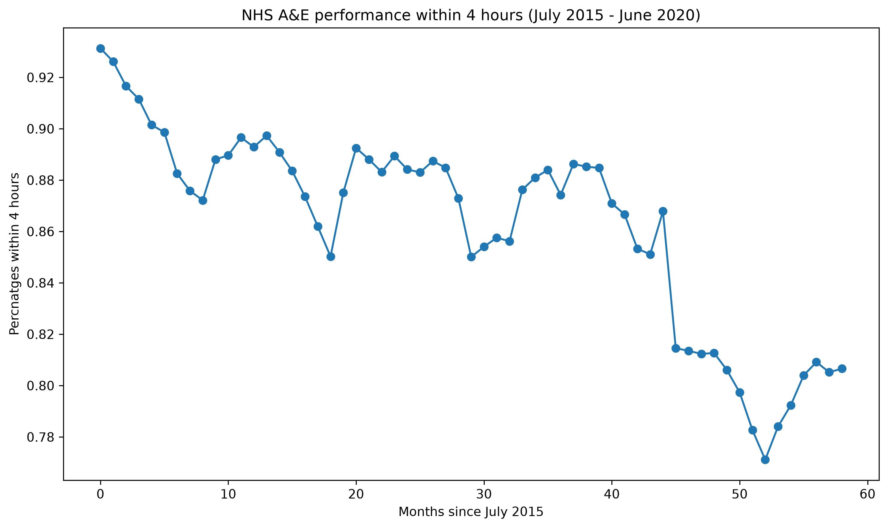

# NHS DATA ANALYSIS

Investigating whether the NHS and A&E performance against the 4 hour target has seen a decline across trusts between July 2015 to June 2020
## 📊 Report
Full write-up: [Steam_Data_Analysis.pdf](./NHS_Analysis_Report.pdf)

## Key Findings
- Regression R-value: r =-0.845
- Regression P-value: p = 0.0000000000
- P-Value (Scientific): 4.240e-17 
## Visuals

## Data Source
[A&E attendances England](https://www.kaggle.com/datasets/treich/ae-attendances-england), by Treich , via Kaggle

## Tools
Python, pandas, seaborn, matplotlib, numpy, scipy
